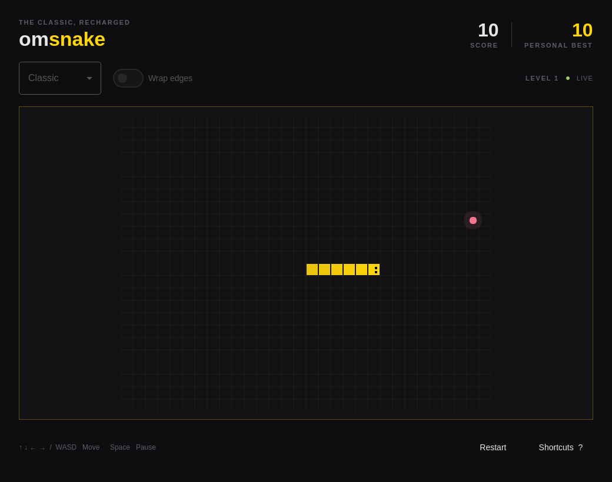

# Omsnake

A native Snake game for Omarchy, written in C++ and Qt Quick. Smooth movement,
buffered turns, three difficulty levels, optional wraparound edges, and a pace
that grows every five bites. High scores save automatically and atomically.
The game pauses when its window loses focus.

The palette, light/dark appearance, corner radius, and language follow Omarchy
live. English, Danish, and Arabic catalogs are included; other languages fall
back to English. The board's directions stay consistent in right-to-left layouts.

## Controls

| Key | Action |
| --- | --- |
| Arrows / WASD | Steer |
| Space | Start, pause, resume, or play again |
| Escape | Pause |
| R | Restart, with confirmation during a run |
| F11 | Toggle fullscreen |
| ? / F1 | Show shortcuts |
| Q | Quit |

Pick Chill, Classic, or Blitz and turn Wrap edges on or off before a run.
The best score is shared across modes and stored in
`~/.local/share/omsnake/scores.json`.

## Build and test

Requires a C++17 compiler, CMake, Make, Qt 6 Base, Declarative, SVG, and Wayland.

```sh
bin/build
bin/test
build/omsnake
cmake --install build --prefix "$HOME/.local"
```

Launch **Omsnake** from the app launcher (`Super + Space`).

The tests exercise real gameplay, atomic score persistence, self/wall collisions,
wraparound, victory, keyboard controls, all catalogs, live theme and language
changes, and Hyprland configuration events using a fake local socket. The real
QML window is tested offscreen, failing on any QML warning. Test screenshots
in `build/` include dark, light, Danish, and Arabic layouts.

The supplied Arch CI follows the Omarchy app template. It requires a future
package recipe in `omacom/omarchy-pkgs` before its dependency-install step can
run; local `bin/test` is ready now. This is a local user installation, with no
GitHub release or public package created.

## License

MIT. Theme, translator, build scripts, CI, and the baseline test helpers follow
Omarchy's app templates, with attribution retained in LICENSE.
